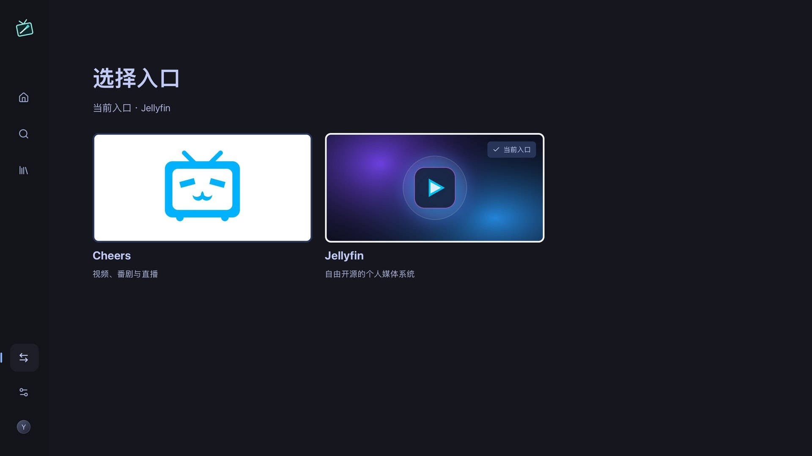
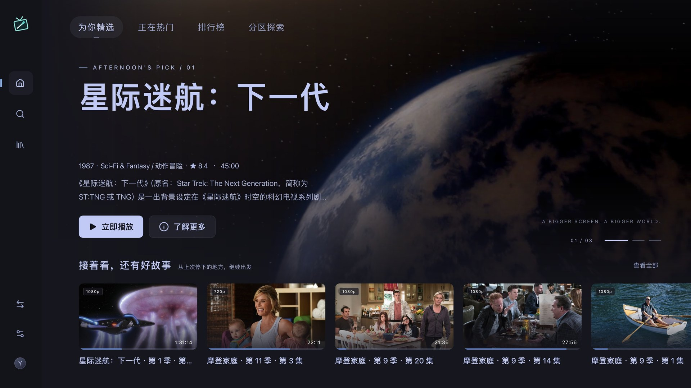
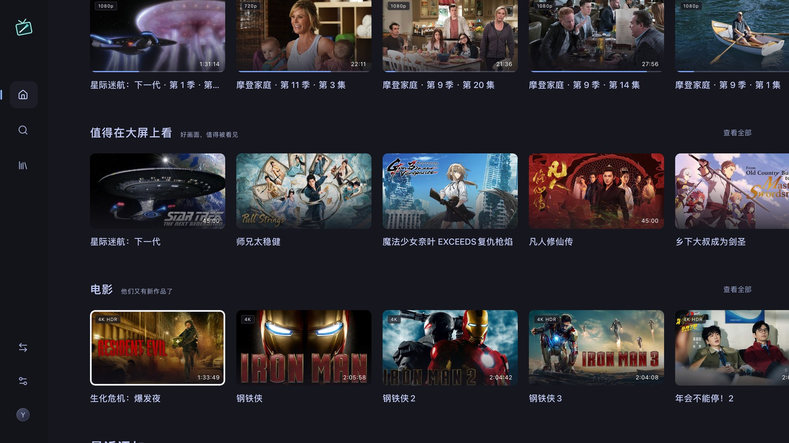
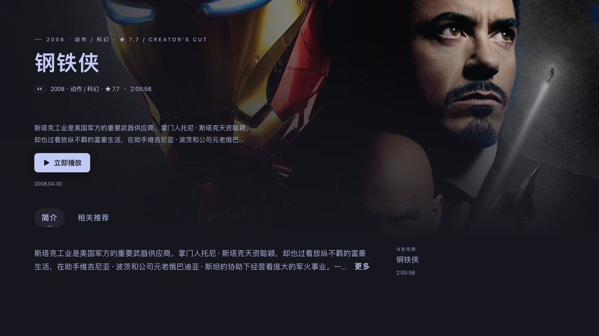
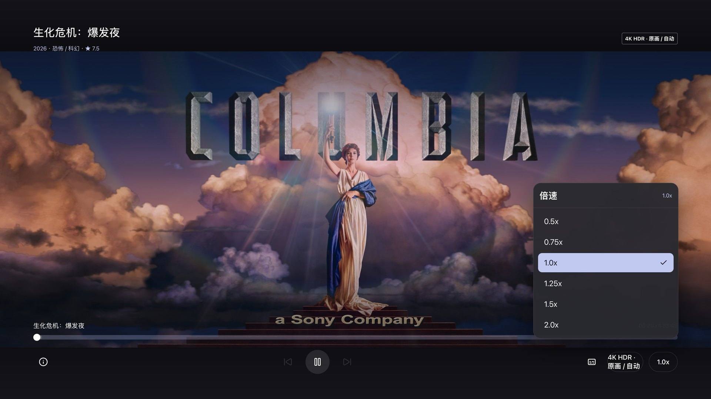

# mikutv-plugin-jellyfin

Official [Jellyfin](https://jellyfin.org/) content source plugin for [MikuTV](https://github.com/yuchanns/MikuTV) on Apple TV (tvOS).

## Screenshots

| Sources | Home & Hero Showcase |
| :---: | :---: |
|  |  |

| Movies & 4K HDR Shelves | Cinema Detail View |
| :---: | :---: |
|  |  |

| 4K HDR MKV → Native HLS Playback |
| :---: |
|  |

## Features

- **Zero fixed external domains**: Connects strictly to the self-hosted `http://` or `https://` Jellyfin server URL you enter at sign-in (per-session single-origin allowlist).
- **Multi-server account scoping**: Account sessions are scoped per Jellyfin server (`serverId:userId`), making it seamless to switch between LAN and remote servers.
- **Home & Library Browsing**: Featured Hero showcase, Continue Watching, Recently Added, Movies, TV Shows, Top Rated, Most Played, and per-library filtering.
- **Native Apple TV 4K HDR Playback**: Direct Play for `mp4`/`mov`/`m4v` (`H.264`/`HEVC` + `AAC`/`AC3`/`EAC3`), and zero-reencode 4K HDR / Dolby Vision HLS remuxing for `mkv` streams without unnecessary server-side subtitle burn-in.
- **Subtitles & Progress Sync**: Automatic external WebVTT subtitle delivery and watch progress reporting back to Jellyfin.
- **Multilingual**: Localized metadata and shelves in Simplified Chinese, English, and Japanese (`host.locale.current()`).

## Installation in MikuTV

1. Open **Settings → Plugins → Discover Plugins** (or **Install from Repo** and enter `yuchanns/mikutv-plugin-jellyfin`).
2. Install **Jellyfin** and switch to it from **Sources**.
3. Enter your Jellyfin server URL (e.g. `http://192.168.1.10:8096`), username, and password.

## License

Apache-2.0
